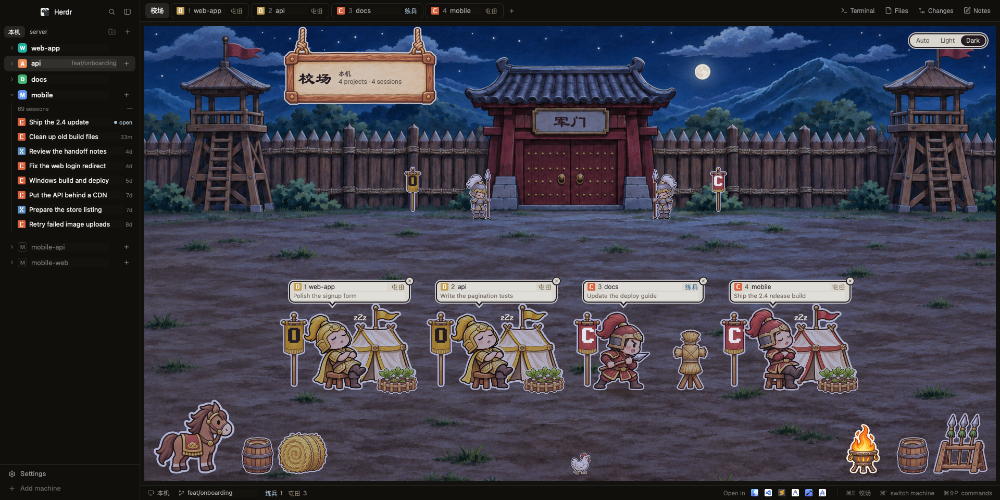

# 三国 Sanguo

**A Three Kingdoms drill ground for your coding agents, as a [Herdr](https://herdr.dev) layout.**

Every coding session on a machine becomes a soldier on a painted 校场 (drill ground). It trains while its CLI works, kneels with a blinking `!` when it needs you, beats a drum when it's done, and naps by its tent when idle. One glance across the camp tells you who needs you.



## What's in it

- **The 校场.** Every session on the machine has a station: its kingdom's banner, its soldier acting out the status, and a bubble with the project and the session's title. Day and night art switch on their own (Auto), or pin Light or Dark.
- **Kingdoms mark the CLI.** Claude Code is 吴 Wu (red, C), Codex is 魏 Wei (blue, X), Antigravity is 蜀 Shu (green, A), and anything else, OpenCode included, is 群 Qun (gold).
- **Browser-style session tabs**, numbered 1 to n, with `+` right after the last one. Each tab takes its session's title as its name, so Herdr's own alerts say which session finished or needs you. Beside an open session, the sidebar shows a card per session: title first, then project, then status and its ⌘ key.
- **Projects and their history.** Each project lists its past sessions from the CLIs' own records, one line each. A click jumps to an open session or resumes a closed one.
- **New Project** browses folders on any machine and can make a new folder right there, so there's no trip to Finder.
- **New Session**, with a searchable project picker that starts on the project you're in, and a searchable list of that project's sessions to resume.
- **Changes**, a git view: staging checkboxes, diffs, branches, fetch, pull, push, stashes, history, and ✨ commit messages written by your CLI.
- **Notes**, a tabbed scratchpad that saves as you type. Notes belong to a machine, and every window connected to it shows the same ones.
- **Several machines.** Each machine Herdr connects to has its own camp, projects, history and notes, stored on that machine. Switch with the pills at the top of the sidebar or ⌘`.

## The statuses

| | Word | On the drill ground |
|---|---|---|
| Working | 练兵 | drills at a straw dummy |
| Needs you | 候令 | kneels by a table, a `!` blinking; the bubble says what it asks |
| Done | 报捷 | cheers by a drum |
| Idle | 屯田 | rests by its tent, `zZz` |
| Not reporting yet | 未报 | stands by its tent |
| Plain terminal | 闲置 | a recruit with a hoe |

## Install

Give your coding agent this repository's URL and ask it to add the layout to Herdr. Herdr's own instructions tell it how: it copies the files without overwriting yours, merges the keys, checks the mod, and switches you to the layout. `ctrl-shift-l` switches back.

By hand, into your Herdr home (`~/.config/herdr-app`):

1. Copy `layouts/sanguo.json` and `layouts/sanguo.png` to `layouts/`, `themes/sanguo.json` to `themes/`, and `mods/sanguo/` to `mods/`. If any of those names are taken, rename the new ones.
2. Merge `keys.json`'s `layout:sanguo` section into your `keys.json`.
3. Check it: `herdr-app check ~/.config/herdr-app/mods/sanguo`.
4. Switch to it: `herdr-app do layout.switch --name sanguo`, or pick it in Settings.

## Requirements

- **Herdr** with mods. The layout starts from Herdr's `main` layout, version 0.1.12.
- **macOS** for the full look. The brush fonts (Baoli SC, Hannotate SC), Finder, Terminal and the "Open in" app icons are macOS. Elsewhere it runs with fallback fonts and fewer "Open in" choices.
- **Optional:** the coding CLIs you use (Claude Code, Codex, OpenCode, Antigravity), `git` for Changes, and `sqlite3` to read Codex, OpenCode and Antigravity history.

## Keys

| Key | Does |
|---|---|
| ⌘T | New session |
| ⌘N | New project |
| ⌘E | Back to the 校场 |
| ⌘J | Notes |
| ⌘1 … ⌘0 | Sessions 1 to 10 |
| ⌃1 … ⌃9 | Projects 1 to 9 |
| ⌘⌥[ ⌘⌥] | Previous or next project |
| ⌘` | Next machine |

## What it runs and reads

Before you install a mod, you should know what it does on your machine:

- **Runs programs:**
  - `sh` and `git`;
  - `sqlite3`, read-only, for session history;
  - `open` and `osascript` for "Open in" and app icons;
  - `ssh` to open Terminal on a remote session;
  - your coding CLI, only when you press ✨ for a commit message.

  On another machine, these run there through Herdr.
- **Reads** the CLIs' own session records, to list and resume past sessions:
  - `~/.claude/projects/` and `~/.claude/sessions/`;
  - `~/.codex/state_*.sqlite`;
  - `~/.local/share/opencode/opencode.db`;
  - `~/.gemini/antigravity*/conversation_summaries.db`.
- **Writes** only its own data, in each machine's `~/.config/herdr-app/data/sanguo/`:
  - the project and session log;
  - notes;
  - app icons.
- **Network:** none of its own. Only git (fetch, pull, push) and the CLI that ✨ runs.

## Make it yours

- **Editor for Files:** `EDITOR` in `mods/sanguo/remote-files.js`, the app name `open -a` takes. It's VS Code here.
- **When day turns to night:** `DAWN` and `DUSK` in `mods/sanguo/time-of-day.js` (07:00 and 19:00).
- **Keys:** your `keys.json`, section `layout:sanguo`.

## In this repository

```
RECIPE.md            the full brief to build it from scratch
LICENSE              The Unlicense: public domain
preview.png          the screenshot above
keys.json            the keys it expects
layouts/sanguo.json  the layout (and sanguo.png, its picture in Settings)
themes/sanguo.json   the theme
mods/sanguo/         the mod: one role per block of the layout, its scripts, icons and art
```

[RECIPE.md](RECIPE.md) describes everything in detail: every region and its size, every behavior, how it's built, what tripped the build up, and checks that prove a build works. herdr.dev reads it, and an agent can rebuild the layout from it alone.

## License

Public domain, under [The Unlicense](LICENSE). Copy it, change it, share it or sell it, for anything, with no need to credit anyone.
