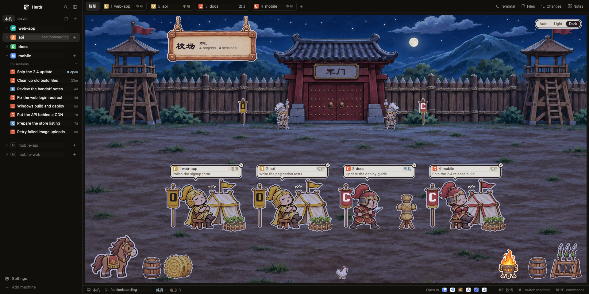

# 三国 Sanguo

A Three Kingdoms drill ground for your coding agents. Every session on a machine is a soldier on a painted 校场 (drill ground): it trains while its CLI works, kneels by a table with a blinking "!" when it needs you, beats a drum when it's done, and naps in its tent when idle. Around the yard sit everything you need to run agent sessions across machines: browser-style session tabs, a project list with each project's past sessions to resume, a git Changes view, and per-machine Notes. It's dark, warm and quiet; only what needs you is loud.

## What you see

The window has no title bar (`titlebar: none`; macOS traffic lights at `[12, 16]`). Colors come from the `sanguo` theme: background `#181612`, foreground `#e6dcc6`, accent `#d9613f`, primary button `#c8553d` on `#fff8e8`; status colors working `#a9c0d0`, blocked `#f2b441`, done `#7fc28f`, idle `#8f8570`. 1px dividers in the theme's border color.

Left to right:

- **Sidebar**, 268px (44 to 480). Top to bottom:
  - **Brand**, 46px: the Herdr mark, search and a sidebar toggle.
  - **Machine bar**, 31px: one pill per machine (`本机` is this computer, then each connected one by name). A pill shows a yellow count of sessions that need you there. On the right sit two 26px buttons: a folder-plus for **New project** and `+` for **New session**. In a narrow sidebar only `+` remains.
  - **The list**, which depends on the center view:
    - **On the 校场:** the machine's projects. Each row (30px) has a chevron, a colored 18px initial square, the name, an unusual git branch or repo (main/master are left out), and ±dirty, ↑ahead and ↓behind counts. A dot means done or blocked, and `+` (on hover or the selected row) starts a session there. Saved projects with no session open sit below, dimmed, with outlined initials.
    - **Beside a session, Changes or Notes:** a 校场 card (a gate thumbnail, the machine, "4 projects · 4 sessions", ⌘E), then one card per session, described below.
  - **Footer**, 69px: Settings and Add machine.
- **Work area**:
  - **Tab bar**, 42px: `校场` (or `× 回校场` away from it), then one tab per session on the machine, numbered 1..n, each 150 to 230px with the CLI's mark, number, project and status word. After the last tab sits `+` (New session); when the tabs overflow they scroll sideways and `+` stays at the far right. On the right: Terminal, Files, Changes and Notes buttons.
  - **Center**, a stack of four blocks with 10px radius, one shown at a time:
    - **校场 (field):** a painted camp (palisade, watchtowers, a gate named 军门 with two guards) at day or night. A hanging sign shows `校场`, the machine and the counts. Each session is a station: its kingdom's banner, its soldier, and a parchment bubble (236px wide) with the mark, number, project, status word and session title. A blocked session shows what it's asking instead of the title. Flags on the wall show which kingdoms are serving, and props fill the corners (horse, hay, barrels, brazier, weapon rack, a chicken). A pill at the top right picks Auto, Light or Dark.
    - **Session:** the terminal panes, each with a 30px header.
    - **Changes:** the shown project's git view, described below.
    - **Notes:** the machine's scratch notes, described below.
  - **Status bar**, 28px: machine, branch, status counts with their words, "Open in" app icons (Finder, then installed editors), and key hints.
- **Side panel**, 368px (280 to 900), hidden by default: Files.

**Session card** (sidebar beside a session): a 62×58 thumbnail of the yard with the session's soldier acting out its status, then three lines:
1. The CLI's mark and the session's title, bold. Until the CLI names it, the tool's name shows, muted.
2. The project.
3. The status word at the left, what it's doing now in the middle (left out when that only repeats the title), and its ⌘ key at the right.

The open session's card has its kingdom's color as border; a blocked one, the blocked color.

**Kingdoms** mark which CLI a session runs: Claude Code is 吴 Wu (red `#d9613f`, mark C), Codex is 魏 Wei (blue `#5b8fc7`, X), Antigravity is 蜀 Shu (green `#5fa777`, A), anything else (OpenCode, pi…) is 群 Qun (gold `#c29f55`, its first letter). A plain shell is an unmarked recruit.

## How it behaves

**Statuses** (the word is drawn in Hannotate SC):

| Status | Word | On the 校场 |
|---|---|---|
| working | 练兵 | drills at a straw dummy, dust kicking up, in time |
| blocked | 候令 | kneels by a table with a blinking `!`; its bubble shows what it asks. The only thing that moves loudly |
| done | 报捷 | cheers by a drum, sparkles blinking |
| idle | 屯田 | sits by its kingdom's tent with crops, `zZz` cycling |
| not reporting | 未报 | stands awake by its tent (an agent at a startup prompt, before its first report) |
| plain terminal | 闲置 | an unmarked recruit stands by a hoe |

Guards stand at attention by day and nap by night. Motion stops when Herdr isn't in front and when no session is open, to save battery.

**Day and night:** Auto shows day art from 07:00 to 19:00 and night art otherwise. Light and Dark force one. The choice is per window.

**Machines:** each machine (this computer and every connected one) has its own 校场, projects, history and notes. A click on its pill goes there and remembers what that machine was showing. ⌘` cycles machines.

**Sessions:**
- A click on a bubble, tab or card opens the session, and ⌘1..⌘0 open sessions 1 to 10.
- The × on a bubble, tab or card ends it. An idle or done session ends at once; a working or blocked one asks first.
- Double-clicking a tab renames it; right-clicking a tab or card opens Herdr's tab menu.

**New session** (⌘T, the tab bar's `+`, the sidebar's `+`, a project's `+`): a 540px dialog.
- **Project:** a dropdown with a search box (name, folder or machine; ↑↓ and Enter), 7 rows at most, grouped by machine, with "New project…" at the bottom. It starts on the project of the session in front.
- **Tool:** chips for the CLIs installed on that machine, plus Terminal.
- **Resume a session:** if the project has history, a searchable list of its past sessions underneath. A click goes to it if open, or resumes it.

**New project** (⌘N, the folder-plus): a folder (typed or Browse; Browse lists folders on a remote machine) and a name. Next saves it and goes on to New Session.

**Project history** (the chevron, or a click on a dormant project's row):
- **Header:** "69 sessions", with ⋯ revealing Rename, Re-import and Delete in place.
- **Rows:** one line per past session (mark, title, "26m"/"4d"/"2w" or a green "● open"). Up to 8 rows show and the rest scroll; "Show 10 more" loads more.
- **Reorder:** hold and drag a dormant project.

**Changes** (Changes button):
- **Files:** the changed files with real staging checkboxes, and a diff of the selected file.
- **Branch picker:** remote branches can be checked out, merged, pushed or rebased. Local branches can be switched to, merged in either direction, rebased or deleted. The current branch can be renamed.
- **Sync menu:** fetch, pull (fast-forward or rebase), push, force push with lease after a confirm, and stashes.
- **History:** the commit list.
- **Commit message:** a ✨ button writes one with Claude Code (Haiku), Codex or Antigravity on that machine.

Escape leaves the message box, then closes Changes.

**Notes** (⌘J or the Notes button): fills the center. Browser-style tabs, each named by its note's first line, with `+` for a new one. Notes:
- **Saving:** 0.6s after you stop typing, and every 4s while you type.
- **Where:** they belong to the machine shown. Every window connected to that machine sees the same notes, and another window's edits arrive within 3s (20s while Herdr is behind).
- **Two windows editing one note:** both versions are kept, yours as its own tab.
- **Closing a tab:** moves the note to a closed folder that keeps the newest 50, with Undo for 10s. A blank tab simply goes.

Escape leaves the text, then closes Notes.

**Open in** (status bar): opens the session's folder in Finder or an installed editor. On a remote machine, only VS Code-family editors through `vscode://vscode-remote/ssh-remote+…`.

**Keys** (`keys.json`, section `layout:sanguo`): ⌘T new session, ⌘N new project, ⌘E 校场, ⌘J notes, ⌘` next machine, ⌘1..⌘0 sessions, ⌃1..⌃9 projects, ⌘⌥[ ⌘⌥] previous or next project.

## Built from

**Layout** `layouts/sanguo.json`, from Herdr's `main` 0.1.12. Each block's content is `{ "mod": "sanguo", "props": { "role": "…" } }`; ids:

- `root` row: canvas background, `terminal_padding [14,12]`, `preview: layouts/sanguo.png`.
  - `sidebar` column, 268px:
    - `brand` (46px): role `chrome`.
    - `sidebar-lists`: `spaces` (role `spaces`, weight 1, min 90) and `agents` (role `camp`, weight 1, min 90). The mod shows one and hides the other.
    - `sidebar-footer` (69px): role `chrome`.
  - `work` column:
    - `tabs` (42px): role `tabs`.
    - `work-body` row:
      - `center` stack:
        - `field`: role `field`.
        - `main`: the terminal panes, pane header role `pane`.
        - `changes`: role `changes`.
        - `notes`: role `notes`.
      - `panel` (368px, hidden): `panel-body` stack with `files` (role `files`).
    - `status` (28px): role `status`.

Dialogs are overlays of the same mod with roles `new-session`, `new-project`, `rename-project`, `delete-project` and `close-session`. `main.js` picks the role class from `props().role`.

**Mod** `mods/sanguo/`, by file:
- **Views:** `field.js` (校场), `camp.js` (session cards), `spaces.js` (project list), `tabs.js` with `tab-strip.js` (shared browser-tab chips), `status.js` (status bar and command handler), `changes*.js` (the git view), `notes.js` (Notes), `files.js` (side panel), `dialogs.js`, `chrome.js`, `pane.js`.
- **Data:** `projects.js`, `machine-store.js` with `machine-store.sh` (per-machine log), `session-log.js`, `session-history.js` with `session-history.sh` (CLI history), `notes-store.js` with `notes.sh`, `git.js`, `machine-script.js` (runs the mod's scripts on any machine).
- **Shared helpers:** `machines.js`, `views.js` (which center view, per machine), `kingdoms.js`, `actors.js`, `time-of-day.js`, `key-hints.js`.

**Shipped mods it uses:** `menu` (tab right-click) and `new-menu` (right-click on `+`), plus icons from `workspace-chrome`, `files`, `pane`, `changes` and `tabs`.

**Herdr calls:**
- **Live data:** `spaces`, `panes`, `agents`, `terminals`, `machines`, `layout`, `focused`, `window`, `settings`, `theme`, `keys`.
- **State:** `shared`/`setShared` (view per machine, shown machine, projects, open histories, time-of-day mode, selected note).
- **Running things:** `exec` (with `on` for remote machines, and `timeout` up to 600000 for git), `readTextFile`, `watchFolder`, `openOverlay`/`closeOverlay`, `notify`, `knownAgents`, `pickFolder`, `nextCommand`, `setAgentOrder`, `appHome`.
- **Commands it runs:** `space.new`, `space.select`, `space.move`, `space.rename`, `tab.new`, `tab.select`, `tab.close`, `tab.move`, `tab.rename`, `pane.focus`, `layout.select`, `layout.show`, `layout.hide`, `window.minimize`, `window.maximize` and `window.close`.
- **Commands it answers** (`sanguo.*`): `new-session`, `new-project`, `field`, `notes`, `changes`, `switch-machine`, `session-N`, `space-N`, `space-next`, `space-prev`, `appearance-auto/light/dark`, `open-in-*`, `open-terminal`.

**Programs it runs, on the machine a project is on:** `sh`, `git`, `sqlite3` (read-only, to read CLI history), `claude`/`codex`/`agy` (only when you press ✨), `open` and `osascript` (Open in, and app icons exported with JXA), `ssh` (Terminal for a remote session).

**Files it reads outside its folder:** the CLIs' own session records, to list and resume past sessions:
- `~/.claude/projects/` and `~/.claude/sessions/`;
- the newest `~/.codex/state_*.sqlite`;
- `~/.local/share/opencode/opencode.db`;
- `~/.gemini/antigravity*/conversation_summaries.db`.

**What it writes:** its own data, in each machine's `~/.config/herdr-app/data/sanguo/`:
- `machine-log.jsonl`: projects and sessions, append-only;
- `notes/*.md`, plus `notes/closed/`;
- `app-icons/`.

**Network:** only through git (fetch, pull, push) and the CLIs ✨ runs.

**Art:** `art/paint/` holds painted PNGs at 2× (backdrop, gate, guards, banners and tents per kingdom; soldiers per kingdom in awake/drill/kneel/cheer/rest poses; dummy, drum, table, crops, hoe, sparks, dust and corner props), with `art/paint/night/` variants. `art/paint/sizes.js` gives each piece's display size. `art/marks/` and `art/marks-soft/` hold the A–Z letter marks. Fonts are Baoli SC (brush) and Hannotate SC (status words), which ship with macOS.

## Watch out

**Herdr's runtime:**
- **No `setTimeout`.** Use `cx.timer.after`/`every`, or a task.
- **A cx goes stale across an `await`.** Keep the `cx` from `init` or a task for async work.
- **`v_virtual_list` rows can't have handlers.** The Changes file list became a plain scroll list for that reason.
- **Scrolling lists paint over a `Popup`.** A scrolling list drawn after a popup covers it, so New Session swaps its Resume list for a same-height spacer while the project dropdown is open.
- **`overflow_x_scrollbar` fills its row; `overflow_x_scroll` doesn't.** Use the latter so `+` can sit right after the last tab.
- **`flex_shrink()` needs a number.**
- **`window()` is null during `init` on a fresh start.** Read it in `render`.

**Remote machines:**
- **Leftovers get killed.** On a remote machine, whatever a command leaves running is killed when the command returns, so long git commands run in the foreground with a long `timeout`, never detached.
- **One argument at a time has limits.** Text sent to a machine as arguments is cut into pieces of 30000 code units, never between a surrogate pair, and a note is capped at 400KB.

**Data and sync:**
- **Wait for a dialog's writes before closing it.** Closing a dialog ends its code, and a write still on its way is lost.
- **Only re-read the project list on project lines.** It is rebuilt from the machine log only when project lines arrive, so a session or import line can't drop a project just added.
- **Skip what this window wrote mid-check.** A background re-read must ignore notes this window wrote after the read began, or it brings back old text.
- **Mod reloads leak memory.** Each mod reload leaks some, and about 25 reloads end in "out of memory". Swap the mod folder in one go, and restart the window after test batches.
- **Start Herdr with a clean environment.** Started from inside a Claude Code shell, Herdr passes `CLAUDECODE` to its terminals, and Claude sessions there silently stop saving.

**Assumptions:**
- **macOS.** Fonts, Finder, Terminal, `open` and `osascript` are macOS; elsewhere the fonts fall back and Open in has less to offer.
- **Editor.** Files opens files in VS Code (`EDITOR = "Visual Studio Code"` in `remote-files.js`, the app name `open -a` takes). Set it to your editor's app name for another. A remote machine's file opens as a local copy, and each save is sent back.
- **Commit-message models.** ✨ uses each CLI's default fast model and needs that CLI signed in on the machine.

**Limits:** 7 rows in the project dropdown, 8 rows in a project's history (scrolls, 10 more per press), 50 closed notes per machine, 10 numbered session keys.

## Done when

- `herdr-app check mods/sanguo` passes with `DEFAULT_ROLE` set to each role in turn: field, camp, spaces, tabs, files, changes, notes, status, pane, chrome, new-session, new-project, rename-project, delete-project, close-session.
- `layout.switch {"name":"sanguo"}` shows the dark camp with the sidebar, tab bar, 校场 and status bar, and `herdr-app status` reports no errors.
- Start a Claude Code session: a red Wu soldier with a C banner appears, and drills at the dummy while it works. When it finishes it cheers at the drum, and later naps by its tent. A permission prompt makes it kneel by the table with a blinking `!`, and its bubble says what it wants.
- ⌘T opens New Session on the project in front; typing in its search filters the projects; a past session in Resume reopens it with its history.
- ⌘J opens Notes; text typed there appears in `~/.config/herdr-app/data/sanguo/notes/<id>.md` within a second; closing the tab and pressing Undo brings it back.
- Changes on a repo lists its changes; ticking a file stages it (`git status` agrees); a commit and push on a remote machine finish without hanging.
- Switching machines shows that machine's own 校场, projects, history and notes.
